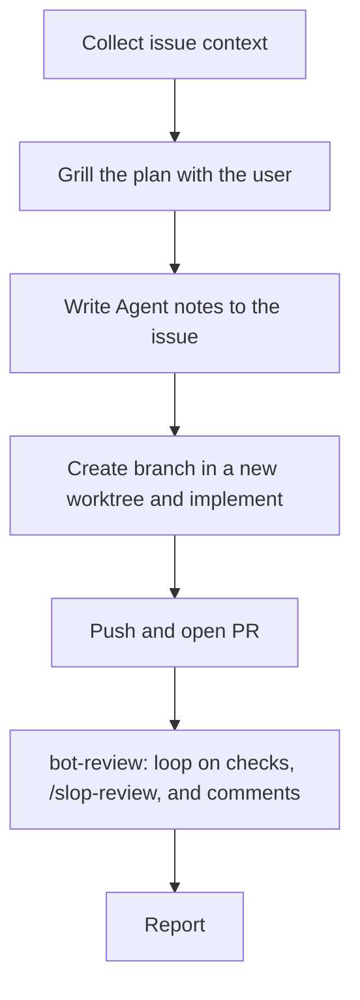

# bot-implement

Takes an issue from GitHub, Linear, or another tracker, from context to a reviewed PR.
You answer questions during the plan.
The agent does the rest without you.

1. **Context**: the agent reads the issue, its comments, images, attachments, linked issues, and linked docs.
2. **Grill**: the agent grills you on the plan with `grilling` and `domain-modeling`, the same as `/grill-with-docs`.
3. **Issue**: the agent writes the plan to an `Agent notes` section in the issue description.
4. **Implement**: the agent creates the branch from the issue in a new worktree, and follows `/implement`.
5. **PR**: the agent pushes the branch and opens the PR.
6. **Review loop**: the agent calls [`bot-review`](../bot-review/README.md).
   Each round, it fixes failed checks, runs `/slop-review`, and answers the PR review comments.
   The loop stops when the PR is green, or after the maximum number of rounds (5 by default).

## Usage

Type `/bot-implement ENG-123` in Claude Code, from the repo that the issue changes.
Add `--rounds <n>` to change the maximum number of review rounds, for example `/bot-implement ENG-123 --rounds 3`.

## Requirements

- A tool that can read the issue: `gh` for GitHub, the Linear MCP server for Linear, or another MCP server.
  [`trackers.md`](trackers.md) has the commands for each tracker.
- `gh`, authenticated for the repo.
- The `mattpocock-skills` and [`bot-review`](../bot-review/README.md) skills, and the requirements of `bot-review`.
  `grill-with-docs` and `implement` are user-invoked, so this skill calls `grilling` and `domain-modeling` directly, and reads the `implement` file at `~/.claude/skills/mattpocock-skills/skills/engineering/implement/SKILL.md`.
