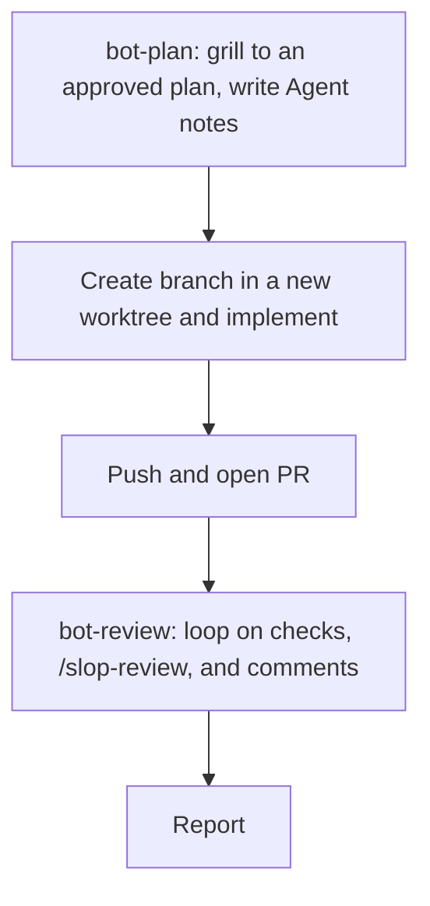

# bot-implement

Takes an issue from GitHub, Linear, or another tracker, from context to a reviewed PR.
You answer questions during the plan.
The agent does the rest without you.

1. **Plan**: the agent calls [`bot-plan`](../bot-plan/README.md) with the issue.
   `bot-plan` grills you until you approve the plan, and writes the plan to the issue.
2. **Implement**: the agent creates the branch from the issue in a new worktree, and follows `/implement`.
   The approved public interface is the spec, and the PR body names each difference from it.
3. **PR**: the agent pushes the branch and opens the PR.
4. **Review loop**: the agent calls [`bot-review`](../bot-review/README.md) with the PR, and `bot-review` starts a reviewer subagent for it.
   Each round, the reviewer fixes failed checks, runs `/slop-review`, and answers the PR review comments.
   The loop stops when the PR is green, or after the maximum number of rounds (5 by default).

## Usage

Type `/bot-implement ENG-123` in Claude Code, from the repo that the issue changes.
Add `--rounds <n>` to change the maximum number of review rounds, for example `/bot-implement ENG-123 --rounds 3`.

## Requirements

- `gh`, authenticated for the repo.
- The [`bot-plan`](../bot-plan/README.md) and [`bot-review`](../bot-review/README.md) skills, and their requirements.
- The `mattpocock-skills` skills.
  `implement` is user-invoked, so this skill reads the `implement` file at `~/.claude/skills/mattpocock-skills/skills/engineering/implement/SKILL.md`.
