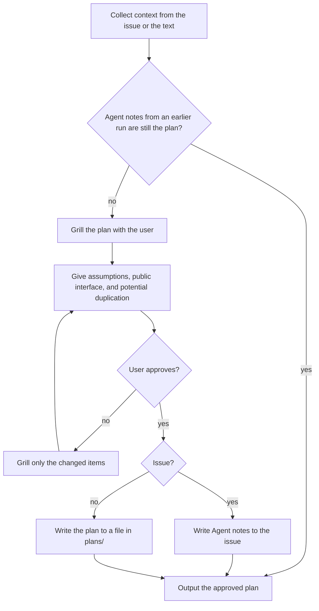

# bot-plan

Takes an issue, or a behavior that you describe, to a plan that you approve.
The agent changes no code.

1. **Context**: the agent reads the issue, its comments, images, attachments, linked issues, and linked docs.
   If you give text and no issue, the text is the source.
2. **Grill**: the agent grills you on the plan with `grilling` and `domain-modeling`, the same as `/grill-with-docs`.
3. **Approval**: the agent gives you three sections of the plan to evaluate.
   - **Assumptions**: each statement that the plan needs, and that you or a source did not confirm.
   - **Public interface**: the added, changed, and removed public symbols of each package that the plan touches, as signatures.
   - **Potential duplication**: each symbol in the repo that does the same work as an added symbol.

   For each change that you ask for, the agent grills only the changed items, and gives you the three sections again.
   The loop stops when you approve.
4. **Write**: the agent writes the approved plan to an `Agent notes` section in the issue description.
   If there is no issue, the agent writes the plan to `plans/<yyyy-mm-dd>-<title>.md` in the root of the repo, and does not add it to git.
5. **Output**: the agent gives the approved plan, and the branch name of the issue or the path of the plan file.

## Usage

Type `/bot-plan ENG-123` in Claude Code, from the repo that the issue changes.
Without an issue, describe the behavior: `/bot-plan add a retry limit to the upload client`.
The plan then goes to a file in `plans/` in the root of the repo.
[`bot-implement`](../bot-implement/README.md) calls this skill as its first step.

## Requirements

- For an issue, a tool that can read it: `gh` for GitHub, the Linear MCP server for Linear, or another MCP server.
  [`trackers.md`](trackers.md) has the commands for each tracker.
- The `mattpocock-skills` skills.
  `grill-with-docs` is user-invoked, so this skill calls `grilling` and `domain-modeling` directly.
