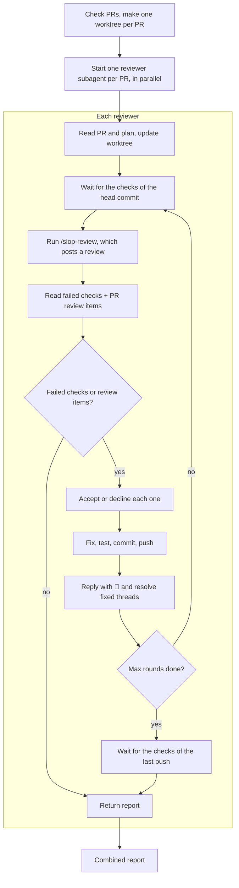

# bot-review

Takes one or more open GitHub PRs to green without you.
The agent starts one reviewer subagent for each PR, and the reviewers work in parallel.
Each round, a reviewer fixes failed checks, runs the `/slop-review` review, and answers the review comments.

1. **PRs**: the agent makes sure that each PR is open, is in this repo, and has its own head branch.
2. **Checkouts**: the agent gets a worktree on the head branch of each PR, one PR at a time.
3. **Reviewers**: the agent starts one subagent for each PR, with [`reviewer.md`](reviewer.md) as its instructions.
   - **Context**: the reviewer reads the PR and the plan in the linked issue, and updates the worktree.
   - **Review loop**: each round, the reviewer waits for the checks, reads the failed checks, runs the `/slop-review` review, and reads the PR review items.
     The reviewer fixes the findings it accepts, replies to each comment, and resolves the threads it fixed.
     It also resolves the `/slop-review` threads it declined, and keeps the declined threads of other reviewers open.
     The loop stops when a round has no findings, or after the maximum number of rounds (5 by default).
4. **Report**: the agent gives you a table of the PRs, and what each reviewer fixed, declined, and left open.

## Usage

Type `/bot-review https://github.com/<owner>/<repo>/pull/<n>` in Claude Code, from a clone of the repo.
To review more PRs in parallel, give more URLs: `/bot-review <pr-url> <pr-url>`.
All PRs must be in the repo of the clone.
Add `--rounds <n>` to change the maximum number of rounds for each PR.
[`bot-implement`](../bot-implement/README.md) calls this skill after it opens the PR.

## Requirements

- `gh`, authenticated for the repo.
- The `slop-review` and [`golang-deslop`](../golang-deslop/README.md) skills.
  The agent looks for `slop-review` in `.claude/skills/` of the repo, then in `~/.claude/skills/`.
- `jq`, for [`wait-checks.sh`](wait-checks.sh).
- Optional: a `gh-review-thread` command with `list`, `reply`, and `resolve` operations.
  The skill uses it for review threads when it exists, for machines where a permission hook stops `gh api graphql`.
