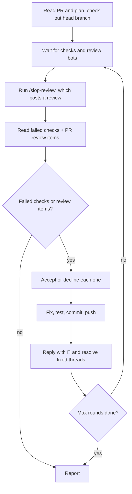

# bot-review

Takes an open GitHub PR to green without you.
Each round, the agent fixes failed checks, runs `/slop-review`, and answers the review comments.

1. **Context**: the agent reads the PR and the plan in the linked issue, and goes to a checkout of the head branch.
2. **Review loop**: each round, the agent waits for the checks, reads the failed checks, runs `/slop-review`, and reads the PR review items.
   The agent fixes the findings it accepts, replies to each comment, and resolves the threads it fixed.
   The loop stops when a round has no findings, or after the maximum number of rounds (5 by default).
3. **Report**: the agent tells you what it fixed, what it declined, and what is still open.

## Usage

Type `/bot-review https://github.com/<owner>/<repo>/pull/<n>` in Claude Code, from a clone of the repo.
Add `--rounds <n>` to change the maximum number of rounds.
[`bot-implement`](../bot-implement/README.md) calls this skill after it opens the PR.

## Requirements

- `gh`, authenticated for the repo.
- The `slop-review` and [`golang-deslop`](../golang-deslop/README.md) skills.
- Optional: a `gh-review-thread` command with `list`, `reply`, and `resolve` operations.
  The skill uses it for review threads when it exists, for machines where a permission hook stops `gh api graphql`.
