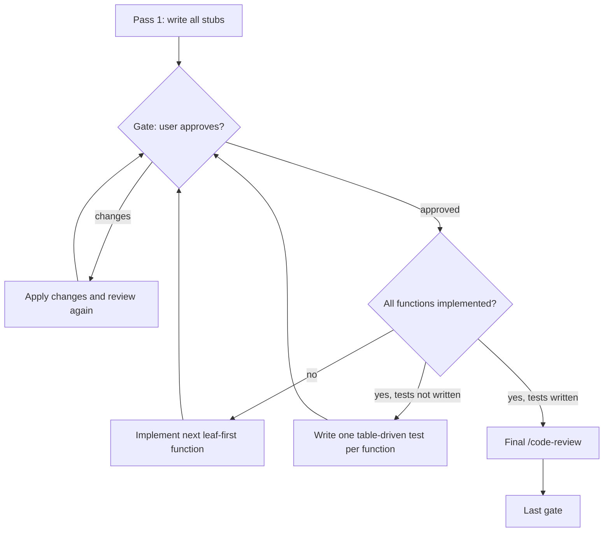

# progressive-implement

Implements a spec or a set of tickets in small passes.
Each pass ends at a gate: the agent reports the pass, reviews the code, and waits for your approval.
Goal is to ensure human-in-the-loop development process and high code quality.
Based on the [`implement`](https://github.com/mattpocock/skills/tree/main/skills/engineering/implement) skill by Matt Pocock.

1. **Stubs**: one pass writes every function as a stub with its signature, a doc comment, and a "not implemented" or zero-value body.
2. **Implementation**: each pass implements one function, from utility functions up to orchestration functions.
3. **Tests**: one pass writes one table-driven test per function.
4. **Final review**: the agent runs `/code-review` on all the work.

Each pass ends with a review of code complexity and of abstraction opportunities.

## Usage

Type `/progressive-implement` in Claude Code and point it at the spec or tickets.
