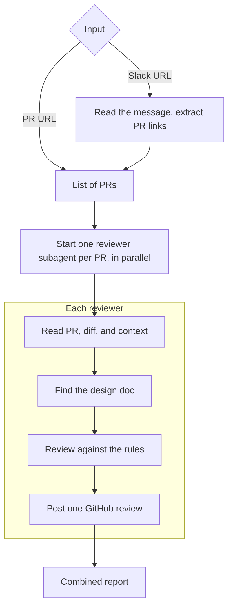

# slop-review

Gives one or more GitHub PRs a strict review, and posts the findings as a GitHub review.
The agent starts one reviewer subagent for each PR, and the reviewers work in parallel.

1. **PRs**: the agent takes one PR URL, or every PR link in one Slack message.
2. **Reviewers**: the agent starts one subagent for each PR, with [`reviewer.md`](reviewer.md) as its instructions.
   - **Context**: the reviewer reads the PR, its diff, the code around the diff, and the review comments that exist.
   - **Design doc**: the reviewer looks for the design doc in the PR links, in the repo, and then in Glean.
   - **Review**: the reviewer checks the Go rules, separation of concerns, logic, architecture, and the design doc.
   - **Post**: the reviewer posts one review, with inline comments and suggested fixes.
3. **Report**: the agent gives you a table of the PRs, with the verdict and the number of findings for each PR.

## Usage

Type `/slop-review https://github.com/<owner>/<repo>/pull/<n>` in Claude Code.
To review every PR in a Slack message, give the message URL: `/slop-review https://<workspace>.slack.com/archives/<channel>/p<digits>`.
[`bot-review`](../bot-review/README.md) calls this skill each round.

## Requirements

- `gh`, authenticated for the repos of the PRs.
- The [`golang-deslop`](../golang-deslop/README.md) skill and the [`cc-skills-golang`](https://github.com/samber/cc-skills-golang) skills, for PRs that change Go code.
- The skill folder at `~/.claude/skills/slop-review`, because the reviewers read `reviewer.md` from that path.
- Optional: Slack MCP tools, for Slack message URLs.
- Optional: Google Drive, Atlassian, Linear, or Glean MCP tools, to find the design doc.
